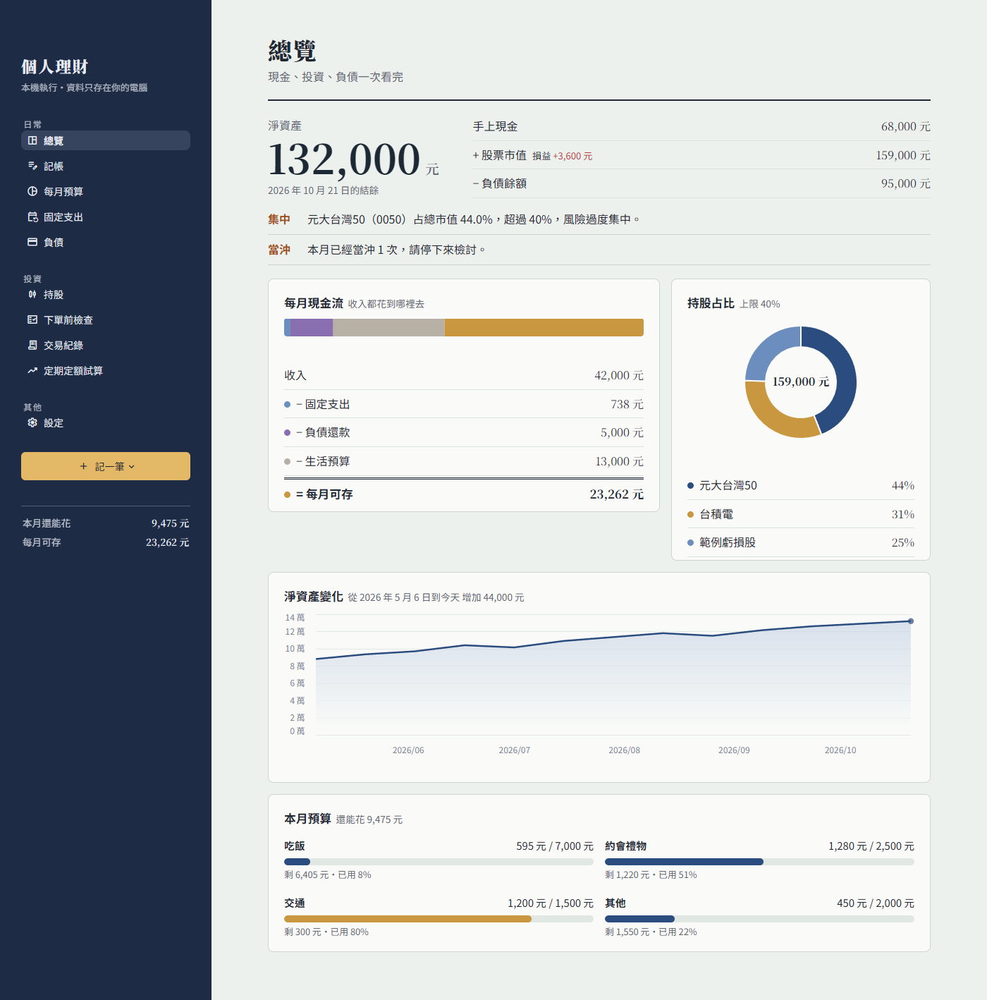
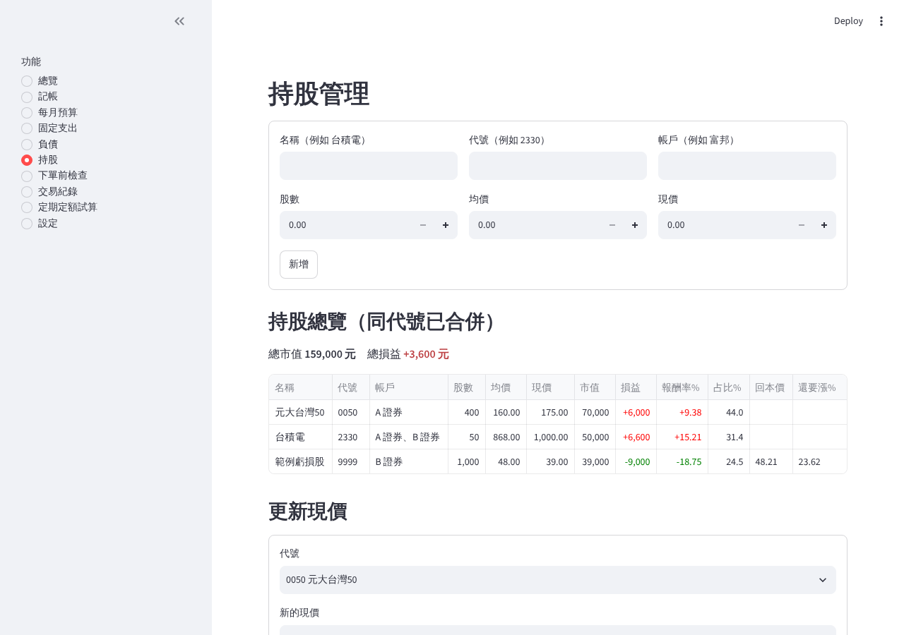
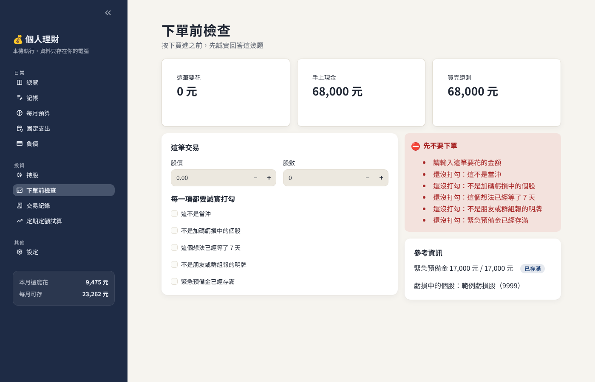
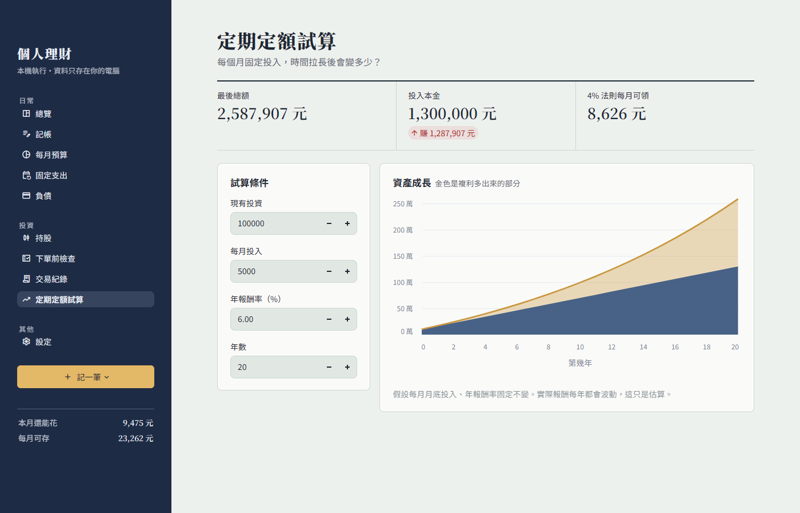
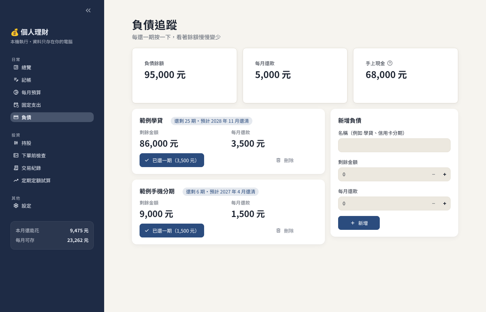
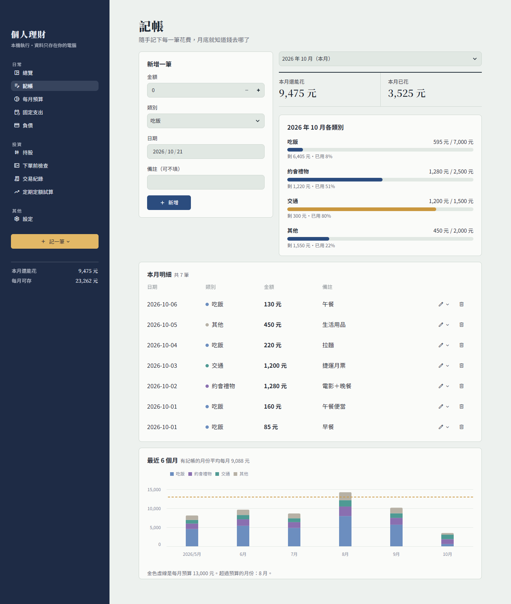
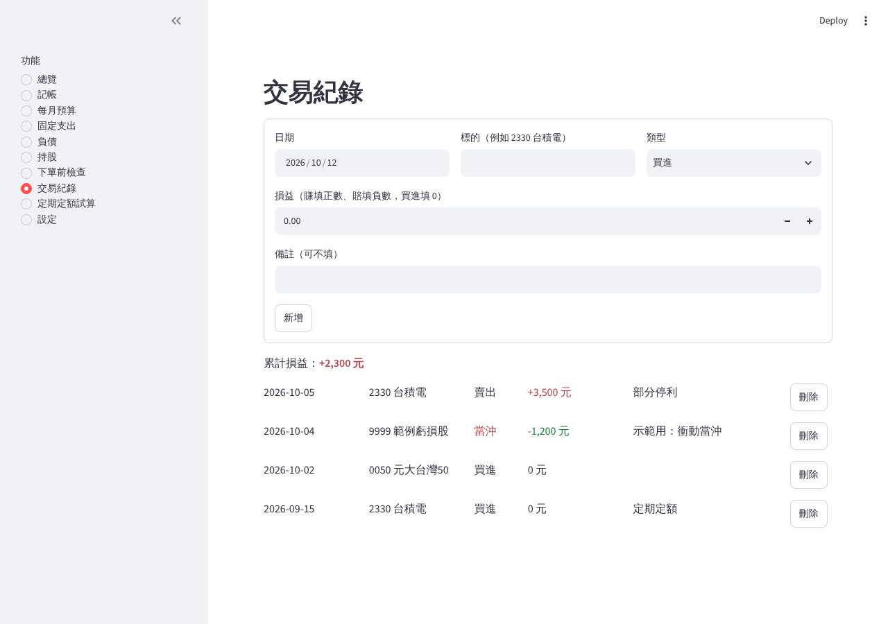
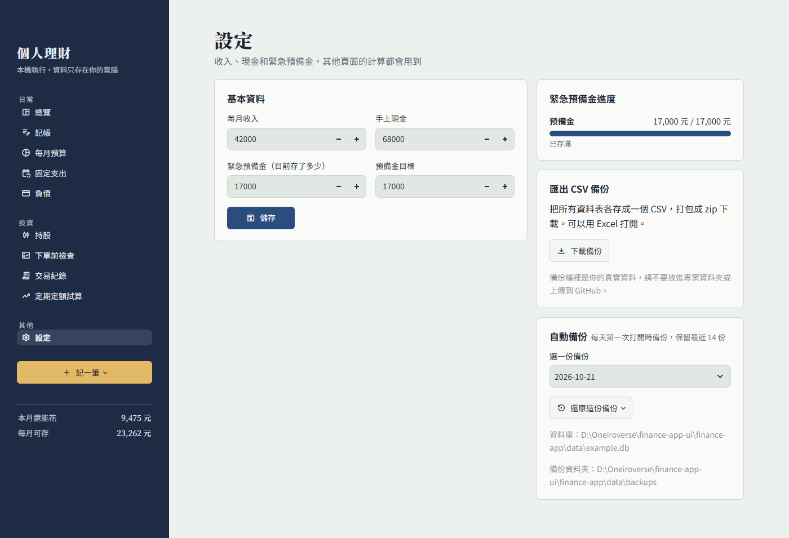

# 個人理財管理系統

用 Python + Streamlit + SQLite 做的個人理財工具。在自己電腦上執行，資料只存在本機，不會上傳到任何地方。
唯一會連網路的功能是「股價自動更新」：只送出股票代號給證交所查報價，可以在設定頁關掉。



> 所有截圖都是用 `seed_example.py` 產生的**虛構範例資料**。

## 下載（Windows）

不想安裝 Python 的話，可以直接下載安裝檔（Windows 10 / 11，64 位元）：

1. 到 [Releases](https://github.com/deven951130/finance-app/releases/latest) 下載 `FinanceApp-Setup-x.y.z.exe`。
2. 點兩下安裝檔，照著精靈按「下一步」。**不需要系統管理員權限。**
3. 開始選單和桌面會出現「個人理財管理系統」，點開就是一個獨立視窗，不用開瀏覽器。

- 第一次安裝如果跳出「Windows 已保護您的電腦」，按「其他資訊 → 仍要執行」（程式沒有付費的數位簽章）。
- 資料存在 `C:\Users\你的名字\FinanceApp\finance.db`，只在你自己的電腦上；每天會自動備份到同一個資料夾的 `backups\`。
- 要更新：直接安裝新版，資料不會遺失。詳細說明見下面的「安裝成 Windows 軟體」。

## 功能介紹

### 日常收支
- **記帳**：輸入金額、類別、日期、備註。顯示當月明細、各類別「已花／預算」進度條，以及本月還能花多少。
  - 可以切換月份看以前的紀錄；每一筆都能直接**修改**或刪除。
  - **最近 6 個月**的花費長條圖（依類別疊起來），金色虛線是每月預算，超支的月份一眼就看得出來。
- **記一筆**：側邊欄的金色按鈕，不管在哪一頁都能馬上記帳。
- **每月預算**：吃飯、約會禮物、交通、其他，各自設定金額。
- **固定支出**：例如電話費、iCloud，可新增、刪除。

「本月還能花多少」= 四個類別的預算總和 − 本月已記帳的支出總和（超支會變負數）。

### 總覽
- **第一次打開**會顯示「開始使用」的三個步驟，按了直接跳到該填的頁面
- **淨資產**大數字，以及它怎麼算出來的（現金 + 股票 + 別人欠我 − 負債 − 未繳卡費）
- **淨資產變化**折線圖：每天打開總覽時記一筆，看得到一路的變化
- **每月現金流**：收入 − 固定支出 − 負債還款 − 信用卡費 − 生活預算 = 每月可存
- 單一個股占總市值超過 40% 時提醒
- 本月當沖次數大於 0 時用橘色提醒（紅色、綠色只留給漲跌）
- 手上現金、股票市值、負債餘額

### 負債
- 名稱、剩餘金額、每月還款
- 按「已還一期」會同時扣剩餘金額和手上現金（現金不夠時不會扣），並留下**還款紀錄**
- 這個月已經還過的話，按鈕會變成「本月已還」；真的要提前多還一期，要再確認一次，避免手滑多扣
- 顯示預計還清月份（假設下一期在下個月繳）

### 別人欠我
- 借給朋友、幫人代墊的錢：誰、多少、哪天借出
- 現在借出去的可以選帳戶（會扣錢）；補記以前借的就不動帳戶
- 「收回一筆」存進選的帳戶，看得到收回進度和收款紀錄

### 信用卡
- 每張卡設定每月幾號要繳，每月填一次帳單金額
- 「繳清」或「繳一部分」，從選的帳戶扣；不會變成記帳的支出（避免和刷卡時記的帳重複）
- 快到繳款日（5 天內）或過了還沒繳清，總覽和信用卡頁都會提醒

### 投資
- **持股**：只要填代號、券商、股數，名稱和現價自動查；均價選填（不填的那檔不算損益，表格顯示「—」）
  - **券商手續費**：每家券商可以設折扣（例如 2.8 折）和最低手續費，買賣時自動算
  - **現價自動更新**：打開總覽或持股頁時自動抓最新股價（盤中是即時價，約延遲幾秒；收盤後是收盤價），5 分鐘內不重抓，也可以按「立即更新」。上市、上櫃、ETF 都可以
  - 資料來源：證交所即時行情；連不上時改用證交所、櫃買中心的官方每日收盤價
  - 只送出股票代號（例如 2330），不送股數或金額；設定頁可以關掉，關掉後完全不連網路
  - 基金、海外股票等查不到報價的，會列出來，請手動修改現價
  - 同一代號在不同券商會合併計算（均價為加權平均）
  - 市值、損益、報酬率、占總市值比例；顏色依台股習慣，紅色是賺、綠色是賠
  - 虧損的個股顯示回本價 = 總成本 ÷ (股數 × (1 − 0.001425 − 0.003))，以及距離現價還要漲幾 %
- **下單前檢查**：輸入股價和股數，五個項目全部打勾、而且金額不超過手上現金，頁面最上面才會顯示「可以下單」，否則用橘色大字顯示「先不要下單」並列出原因
- **交易紀錄**：用「買進／賣出」表單下單後記一筆：持股、帳戶餘額一起更新，手續費和交易稅（股票 0.3%、ETF 0.1%、當沖 0.15%）自動算，送出前先預覽帳戶要付或拿回多少；賣出會算實現損益。也可以只手動記一筆（不動持股和帳戶）
- **定期定額試算**：輸入現有投資、每月投入、年報酬率、年數，畫出每年資產的折線圖，並用 4% 法則換算每月可領金額

### 設定與備份
- 每月收入、手上現金、緊急預備金、預備金目標（預設 17000）
- **自動備份**：每天第一次打開時，把資料庫複製一份到 `backups/`，保留最近 14 份
- **一鍵還原**：在設定頁選一份備份還原；還原前會先把目前的資料另存一份，選錯了還能再還原回來
- **匯出 CSV 備份**：每張資料表一個 CSV，打包成 zip 下載，可用 Excel 開啟

## 截圖

截圖放在 `docs/screenshots/`：

| 持股 | 下單前檢查 |
|---|---|
|  |  |

| 定期定額試算 | 負債 |
|---|---|
|  |  |

| 記帳 | 交易紀錄 |
|---|---|
|  |  |

| 設定與備份 |
|---|
|  |

## 安裝

需要 Python 3.10 以上。

```bash
git clone https://github.com/deven951130/finance-app.git
cd finance-app

# 建立虛擬環境（讓這個專案的套件跟系統分開）
python -m venv .venv

# 啟用虛擬環境
# Windows：
.venv\Scripts\activate
# macOS / Linux：
source .venv/bin/activate

# 安裝套件
pip install -r requirements.txt
```

## 執行

```bash
streamlit run app.py
```

瀏覽器會自動打開 http://localhost:8501 。第一次執行時會自動建立 `data/finance.db`。

### 用範例資料試玩

```bash
python seed_example.py          # 產生 data/example.db（虛構資料，不會動到 finance.db）

# Windows PowerShell
$env:FINANCE_DB="data/example.db"; streamlit run app.py
# macOS / Linux
FINANCE_DB=data/example.db streamlit run app.py
```

### 測試

```bash
pytest
```

## 安裝成 Windows 軟體

想像一般軟體一樣「安裝精靈 → 開始選單 → 點兩下開啟」，可以打包成安裝程式。使用的電腦**不需要安裝 Python**。

### 方法一：在 GitHub 上自動打包（不用在自己電腦裝任何東西）

1. 到 GitHub 這個 repo 的 **Actions** 分頁，選左邊「打包 Windows 安裝程式」，按右邊 **Run workflow**。
2. 大約 10 分鐘後打開那次執行，在最下面 **Artifacts** 下載 `FinanceApp-Setup-…`，解壓縮後就是安裝檔。

GitHub 的雲端機器是全新的，裡面沒有你的資料，所以安裝檔裡也不會有。

### 方法二：在自己的 Windows 電腦打包

1. 安裝 [Inno Setup](https://jrsoftware.org/isdl.php) 6.5 以上（或在終端機輸入 `winget install JRSoftware.InnoSetup`）。這是免費的安裝程式製作工具，只有打包的電腦需要。
2. 在 finance-app 資料夾裡點兩下 `build_exe.bat`。
3. 完成後會自動打開 `dist\installer`，裡面的 `FinanceApp-Setup-1.0.0.exe` 就是安裝檔。

沒有安裝 Inno Setup 也可以跑 `build_exe.bat`，只是只會準備好 `dist\FinanceApp` 資料夾，不會產生安裝檔。

> 為什麼安裝檔裡不是 PyInstaller 的 `FinanceApp.exe`：沒有數位簽章的 exe 會被部分防毒軟體（例如 Trend Micro）直接刪掉，裝好後捷徑點了沒反應。
> 現在安裝檔裝的是 python.org 官方的嵌入式 Python（`pythonw.exe` 有官方簽章）加上這個專案的程式碼，捷徑執行 `pythonw.exe run_app.py`。
> 細節見 `installer/build_runtime.py`。
>
> 同樣的原因，在裝有這類防毒軟體的電腦上**自己打包**時，Inno Setup 可能出現 `EndUpdateResource failed`；這時用上面的「方法一」在 GitHub 上打包即可。

### 安裝與使用

- 點兩下安裝檔，照著精靈按「下一步」。**不需要系統管理員權限**，程式裝在 `C:\Users\你的名字\AppData\Local\Programs\FinanceApp`。
- 裝好後，開始選單和桌面會有「個人理財管理系統」。點開會先出現「正在啟動」，幾秒後就是理財系統的畫面，和一般軟體一樣有自己的視窗，不需要開瀏覽器。**關掉視窗就結束程式。**
- 視窗用的是 Windows 內建的 Edge 網頁元件（WebView2），Windows 10／11 都已經內建。如果打開是空白，可以到微軟網站安裝「WebView2 Runtime」。
- 第一次安裝或執行時，Windows 可能會跳出「Windows 已保護您的電腦」。這是因為程式沒有付費的數位簽章，按「其他資訊 → 仍要執行」即可。
- 要更新：直接安裝新版的安裝檔，會覆蓋舊版。
- 要移除：Windows「設定 → 應用程式」找到「個人理財管理系統」解除安裝，或用開始選單裡的「解除安裝」。

### 你的資料在哪裡

- 資料存在 `C:\Users\你的名字\FinanceApp\finance.db`，**不在**安裝資料夾裡。實際位置顯示在「設定」頁最下面。
- 安裝檔只包含程式，不包含任何資料。更新、重新安裝、解除安裝都**不會**刪掉你的資料；要徹底清除，請自己刪掉那個資料夾。
- 換電腦時，把 `finance.db` 複製到新電腦的同一個位置即可。

如果打不開：程式會跳出對話框說明錯誤，錯誤也會存到 `C:\Users\你的名字\FinanceApp\error.log`，背景伺服器的訊息在同一個資料夾的 `server.log`。

### macOS

在終端機執行 `bash build_mac.sh`，完成後程式在 `dist/FinanceApp/FinanceApp`（目前只有免安裝版）。第一次打開要按右鍵選「打開」。資料存在 `家目錄/FinanceApp/finance.db`。

相關檔案：

| 檔案 | 用途 |
|---|---|
| `run_app.py` | exe 的啟動入口：在背景啟動 Streamlit，再用 pywebview 開一個視窗顯示畫面 |
| `installer/build_runtime.py` | Windows 安裝檔的內容：官方嵌入式 Python + 套件 + 程式碼 |
| `requirements-runtime.txt` | 放進 Windows 安裝檔的套件（固定版本） |
| `FinanceApp.spec` | PyInstaller 打包設定（macOS 用） |
| `build_exe.bat` / `build_mac.sh` | 一鍵打包腳本（Windows 版會接著做安裝程式） |
| `requirements-build.txt` | 打包才需要的套件（PyInstaller） |
| `installer/FinanceApp.iss` | Inno Setup 安裝程式設定：安裝位置、捷徑、解除安裝 |
| `installer/icon.ico` | 程式圖示 |
| `installer/ChineseTraditional.isl` | 安裝精靈的繁體中文翻譯（來自 Inno Setup 官方） |
| `.github/workflows/build-windows.yml` | 在 GitHub 雲端自動打包並實際安裝測試 |

## 技術架構

| 層 | 檔案 | 負責 |
|---|---|---|
| 畫面 | `app.py` | Streamlit 頁面，只負責顯示和接收輸入 |
| 資料 | `db.py` | SQLite 讀寫，所有 SQL 都在這裡 |
| 計算 | `models/` | 純計算函式，不碰資料庫也不碰畫面，方便測試 |
| 測試 | `tests/` | pytest：`models/` 的計算、資料庫功能（還款紀錄、備份還原…），以及用 AppTest 實際跑每一頁 |

```
finance-app/
├── app.py              # Streamlit 主程式
├── db.py               # 資料庫讀寫、CSV 匯出
├── seed_example.py     # 產生虛構範例資料
├── run_app.py          # exe 啟動入口
├── FinanceApp.spec     # PyInstaller 打包設定
├── build_exe.bat       # Windows 打包腳本（exe + 安裝程式）
├── build_mac.sh        # macOS 打包腳本
├── installer/          # Windows 安裝程式設定、圖示
├── models/
│   ├── budget.py       # 本月還能花多少
│   ├── cashflow.py     # 每月現金流
│   ├── debt.py         # 負債：還一期、預計還清月份
│   ├── receivables.py  # 別人欠我的錢：收回進度
│   ├── cards.py        # 信用卡帳單：繳款日、狀態、未繳合計
│   ├── stocks.py       # 持股：合併、市值、損益、回本價
│   ├── fees.py         # 手續費、交易稅、加碼後均價、實現損益
│   ├── precheck.py     # 下單前檢查
│   ├── trades.py       # 交易紀錄統計（當沖次數）
│   └── dca.py          # 定期定額試算、4% 法則
├── .streamlit/config.toml  # 外觀主題：配色、字型、圓角
├── tests/              # pytest 測試
├── docs/screenshots/   # README 截圖（虛構資料）
├── data/               # 資料庫檔案（不會進 git）
├── requirements.txt
└── pytest.ini
```

資料表：`settings`、`budgets`、`expenses`、`fixed_expenses`、`debts`、`holdings`、`trades`。
資料庫路徑預設是專案裡的 `data/finance.db`（exe 版是 `家目錄/FinanceApp/finance.db`），可以用環境變數 `FINANCE_DB` 改成別的檔案。

## 給接手開發的人

專案規則、慣例與目前進度在 [`CLAUDE.md`](CLAUDE.md)；各階段的設計決定與待辦清單在 [`docs/開發紀錄.md`](docs/開發紀錄.md)。

## 隱私

- `data/`、`*.db`、`.env`、`*.csv`、`*.xlsx`、`*.zip` 都列在 `.gitignore`，不會被 commit。
- 匯出的備份檔是你的真實資料，請存在專案資料夾以外的地方。
- 上傳 GitHub 前可以用 `git status` 確認沒有資料庫或備份檔。
- 打包產生的 `build/`、`dist/` 也已排除，不會被 commit。
- 不論是 exe 還是 `streamlit run app.py`，都只接受這台電腦自己連線（localhost），區網裡的其他人連不到；也不會傳送使用統計給 Streamlit。設定在 `.streamlit/config.toml` 和 `run_app.py`。
- 畫面上的中文字型會從 Google Fonts 下載，只是字型檔，不會送出任何財務資料；沒有網路時會改用電腦內建的字型。

## 授權

[MIT License](LICENSE)：可以自由使用、修改、再發布，只要保留版權聲明。下載的 Windows 版裡另外附上 `THIRD_PARTY_LICENSES.txt`，列出打包進去的第三方套件（Streamlit、pandas 等）的授權。

## 免責聲明

這是個人學習用的工具，計算結果僅供參考，不構成任何投資建議。
